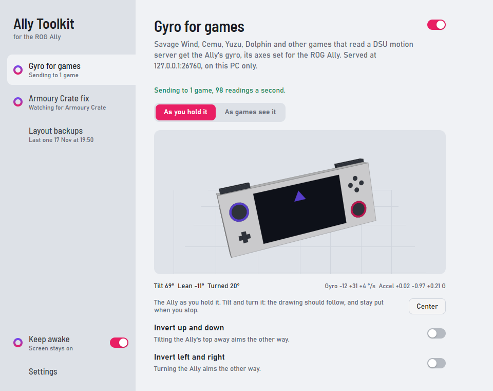
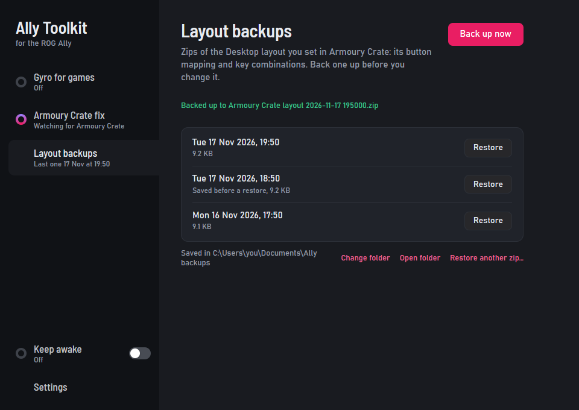
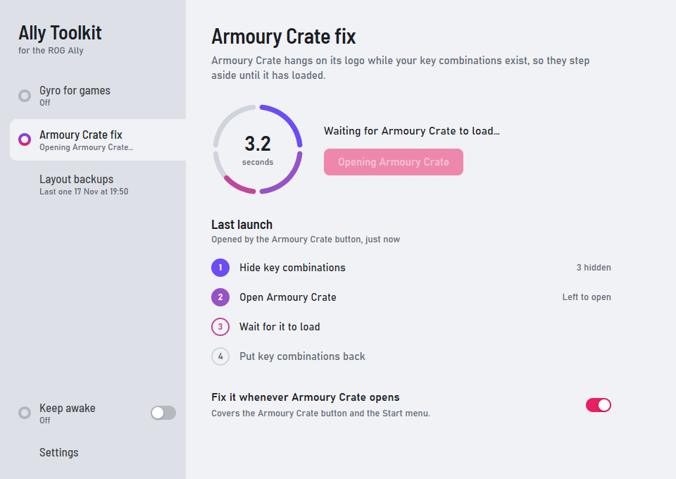
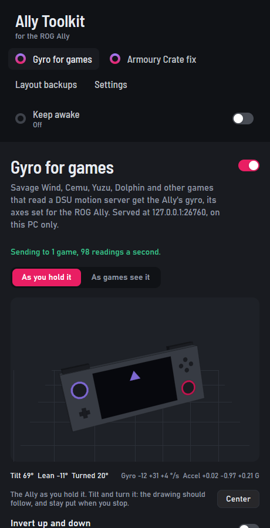

# Ally Toolkit

Extra tools for the ROG Ally family on Windows: the handheld's gyro for games, keeping Windows awake, backups of your Armoury Crate controller layout, and a fix for Armoury Crate hanging on its logo.

It sits in the tray. Click the tray icon to open the window, or right-click it for a menu of the same switches.



## What it does

### Gyro for games

Sends the Ally's own gyroscope and accelerometer to games over a DSU (cemuhook) motion server at `127.0.0.1:26760`, on this PC only. Savage Wind, Cemu, Yuzu, Dolphin and other games that read a DSU server can then aim with motion.

- The axes are set for each model: ROG Ally (RC71L), ROG Ally X (RC72LA), ROG Xbox Ally (RC73YA) and ROG Xbox Ally X (RC73XA).
- A live 3D drawing follows the handheld, either as you hold it or as games see it. If it tilts the wrong way or creeps back after a turn, games will get it wrong too.
- Up and down, and left and right, can each be inverted.
- In Savage Wind, pick **DSU server** (or **Automatic**) under **Options > Controls > Motion source**.

### Keep awake

Keeps the PC and its screen on, like PowerToys Awake. The tray icon shows a green dot while it is on.

### Layout backups



Zips the Desktop layout you set in Armoury Crate: its button mapping and key combinations. Back one up before you change it, and restore any backup later. Before a restore, your current layout is zipped too, so you can go back to it.

Backups go to your user folder by default; **Change folder** picks another.

### Armoury Crate fix (off by default)



Armoury Crate SE could hang on its logo when your Desktop layout had key combinations. The fix moves the key combination files aside while Armoury Crate starts and puts them back once it has loaded, whether it is opened from here, the Start menu or the Armoury Crate button.

ASUS has since fixed the hang, so the fix is hidden until you turn on **Settings > Show the Armoury Crate fix**. That adds its page to the window and an **Armoury Crate fix** menu to the tray.

## Install

Build the installer (see below) and run `build/windows-amd64/armoury-crate-fix-setup-<version>-amd64.exe`. To update, exit the running copy from the tray first, then run the new installer over it.

**Settings > Start with Windows** starts it in the tray when you sign in. **Settings > Theme** picks light, dark, or whatever Windows uses.

## Build

The app is Go with [MyGo](https://github.com/egoist/mygo) for its window and tray. You need Go 1.25 or newer on Windows.

```sh
go test ./...
go run github.com/egoist/mygo/cmd/mygo build
```

The installer and executable land in `build/windows-amd64/`. The version comes from `mygo.json`; bump it for every build you try, so it is clear which one is installed.

To render the window's pages to PNGs for review, as in this README:

```sh
ACF_SNAP=path/to/folder go test -run Snapshots .
```

The window also fits a narrow size, with the tools across the top:



## Notes

- Settings are kept in `%APPDATA%\armoury-crate-fix\settings.json`. The app started as *Armoury Crate Fix*; its files, install and settings keep that name, so updates install over older copies.
- Names and titles are set in [Barlow Semi Condensed](https://github.com/jpt/barlow), licensed under the SIL Open Font License (`fonts/OFL-Barlow.txt`).
- Not affiliated with ASUS. ROG, ROG Ally and Armoury Crate are ASUS trademarks.
